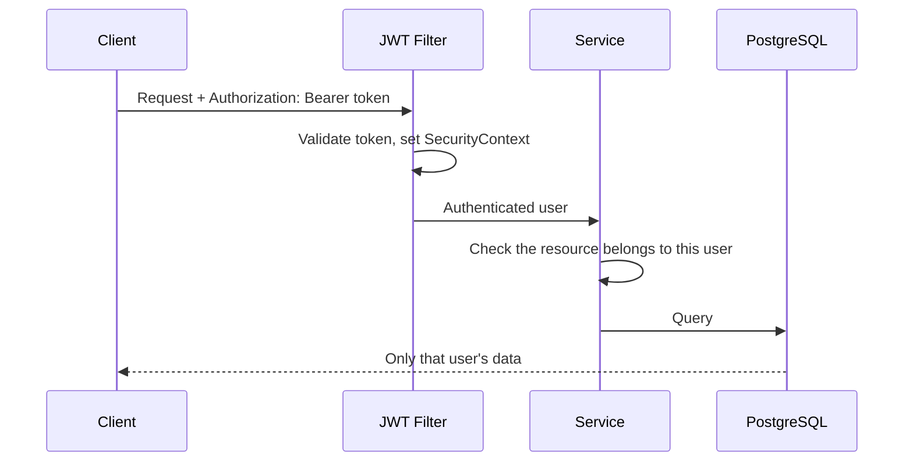
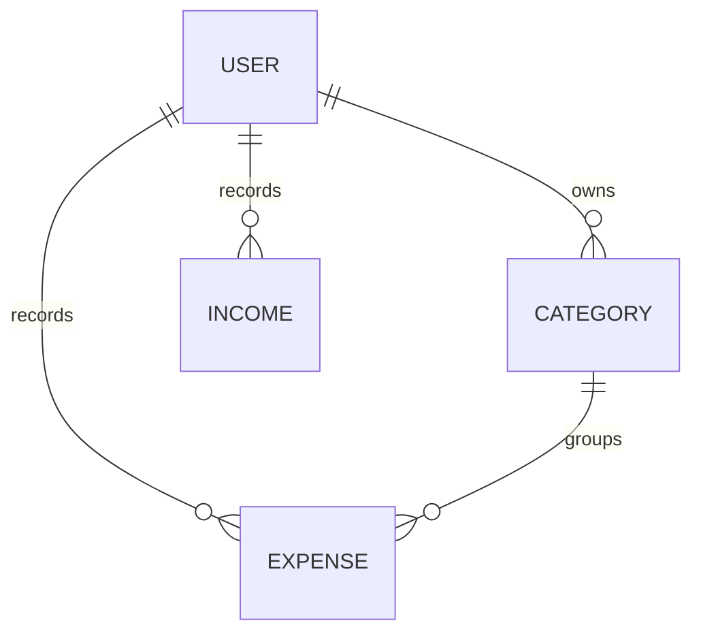

<h1 align="center">💸 ExpenseFlow</h1>

<p align="center">
  A secure personal finance backend where every user sees only their own money.<br/>
  Track expenses and income, organise them by category, and get live spending analytics.
</p>

<p align="center">
  
  
  
  
  
</p>

<p align="center">
  
</p>

---

## ✨ Why this project

Finance data is the kind of data where a security bug is a serious bug. So I built this backend around one rule: **a logged-in user can only ever read or change their own records**, and that rule is enforced on every request rather than assumed.

| 🔐 Secure by design | 📊 Fast analytics | 🧱 Clean structure |
|---|---|---|
| JWT auth, BCrypt hashing, stateless sessions, ownership checks on every resource | Totals and statistics are computed inside PostgreSQL, not in Java loops | Controller → Service → Repository, with controllers depending on service interfaces |

---

## 🚀 Features

| Area | What it does |
|---|---|
| **Authentication** | Register, login, JWT issuing and validation, BCrypt password hashing |
| **Categories** | Per-user and default categories, with ownership validation |
| **Expenses** | Create, update, delete, payment-method tracking, weekly and monthly analytics |
| **Income** | Create, update, delete, income-source tracking |
| **Dashboard** | Total income, total expenses, current balance, recent transactions, expense statistics |

---

## 🧭 How a request flows



## 🗂️ Data model



---

## 🧠 Engineering decisions (and why)

**1. Aggregation in the database**
```java
@Query("SELECT SUM(e.amount) FROM Expense e WHERE e.user = :user")
```
Balances and statistics are calculated by PostgreSQL, so the app doesn't load every record into memory. It uses less memory and stays quick as data grows.

**2. Ownership checked on every operation**
The authenticated user is read from the JWT and compared with the resource's owner before anything is read, changed or deleted. This prevents one user from reaching another's financial records.

**3. Controllers depend on interfaces**
Business logic is separate from API handling, which keeps the code easier to maintain and test.

**4. Lifecycle hooks for entity setup**
JPA lifecycle callbacks set timestamps, default roles and metadata automatically, so none of it is forgotten in the service code.

---

## 🐛 Problems I ran into

| Problem | How I solved it |
|---|---|
| Protected endpoints returned authorization errors after adding JWT | Wrote a custom JWT filter that fills Spring Security's `SecurityContextHolder` once the token is validated |
| Users must never see each other's data | Extract the user from the token and check ownership before every business operation |
| Plain-text passwords are unsafe | Hash with BCrypt before saving, and verify with BCrypt at login |

---

## 🔌 API

<details>
<summary><b>View all endpoints</b></summary>

| Method | Endpoint | Description |
|---|---|---|
| POST | `/user/register` | Create an account |
| POST | `/user/login` | Log in and receive a JWT |
| DELETE | `/user/{userId}` | [Delete own account: confirm ownership is checked] |
| POST / GET | `/categories` | Create / list categories |
| PUT / DELETE | `/categories/{id}` | Update / delete a category |
| POST / GET | `/expenses` | Create / list expenses |
| PUT / DELETE | `/expenses/{id}` | Update / delete an expense |
| GET | `/expenses/weekly` · `/expenses/monthly` | Spending analytics |
| POST / GET | `/income` | Create / list income |
| PUT / DELETE | `/income/{id}` | Update / delete income |
| GET | `/dashboard` | Balance, totals, recent transactions |

</details>

**Quick example**
```http
POST /user/login
{ "email": "user@example.com", "password": "••••••••" }
```
```json
{ "token": "eyJhbGciOi..." }
```
Send the token on later requests as `Authorization: Bearer <token>`.

---

## ▶️ Run it locally

```bash
git clone <repository-url>
cd <repository-folder>
```
1. Create a database: `CREATE DATABASE expense_tracker;`
2. Set your connection details (use environment variables, never commit real credentials):
```properties
spring.datasource.url=jdbc:postgresql://localhost:5432/expense_tracker
spring.datasource.username=${DB_USERNAME}
spring.datasource.password=${DB_PASSWORD}
```
3. Start it:
```bash
mvn spring-boot:run
```

## 🧪 Tests
```bash
mvn test
```
[One line on what's covered, e.g. "service-layer unit tests with JUnit 5 and Mockito". Delete this section if tests don't run yet.]

---

## 🗺️ Roadmap

- [ ] React frontend (in progress)
- [ ] CI/CD with GitHub Actions
- [ ] Docker deployment and a live demo
- [ ] Budget planning and email notifications

---

## 👩‍💻 Author

**Akshita Sharma** · Java / Full-Stack Developer
[LinkedIn](https://www.linkedin.com/in/akshita-sharma-188773219/) · akshitasharma0683@gmail.com

<p align="center"><sub>If this project helped you, a ⭐ is appreciated.</sub></p>
